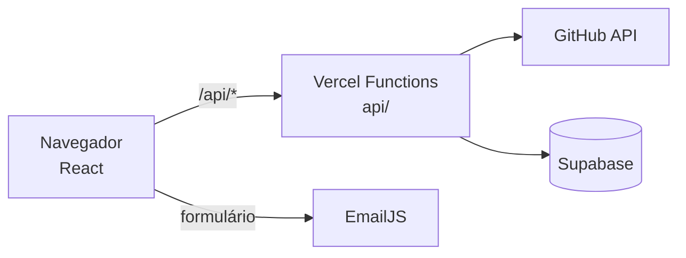

# 💼 Portfólio

<table>
  <tr>
    <td width="800px">
      <div align="justify">
        Este é o meu <b>portfólio pessoal</b>. A página única apresenta quem eu sou, minha stack, meus projetos, minha experiência e um formulário de contato. Os dados do GitHub e o contador de visitas vêm de <b>funções serverless próprias</b> na Vercel, com o banco no <b>Supabase</b>. O site funciona em <i>dois idiomas</i> e <i>dois temas</i>, segue um <b>design system</b> próprio e também roda em <b>Docker Compose</b>.
      </div>
    </td>
  </tr>
</table>

---

## 🚧 Status do Projeto

[](https://github.com/joaom-abreu/portfolio/actions/workflows/ci.yml)
[](https://github.com/joaom-abreu/portfolio/releases)
[](#-licença)
[](https://www.joaomario.dev)

        

---

## 📚 Índice

- [Links Úteis](#-links-úteis)
- [Sobre o Projeto](#-sobre-o-projeto)
- [Funcionalidades Principais](#-funcionalidades-principais)
- [Tecnologias Utilizadas](#-tecnologias-utilizadas)
- [Arquitetura](#-arquitetura)
- [Instalação e Execução](#-instalação-e-execução)
- [Deploy](#-deploy)
- [Estrutura de Pastas](#-estrutura-de-pastas)
- [Demonstração](#-demonstração)
- [Testes](#-testes)
- [Documentações utilizadas](#-documentações-utilizadas)
- [Autor](#-autor)
- [Licença](#-licença)

---

## 🔗 Links Úteis

- 🌐 **Site publicado:** [joaomario.dev](https://www.joaomario.dev)
- 🎨 **Design system:** [joaomario.dev/design](https://www.joaomario.dev/design)
- 🖼️ **Protótipo no Figma:** [abrir o arquivo do portfólio](https://www.figma.com/design/CZNCwLiWEEIQhAxpMmIzC2/portfolio)
- 🩺 **Status da API:** [joaomario.dev/api/health](https://www.joaomario.dev/api/health)

---

## 📝 Sobre o Projeto

O portfólio nasceu como o LAB01 de DIAW, na PUC Minas, mas foi pensado para ser usado de verdade: é o link que eu mando em processos seletivos de estágio. Ele mostra em uma página **quem eu sou, o que eu já construí e como falar comigo**, sem depender de um currículo estático que fica desatualizado.

Como o foco dos meus estudos é **back-end e engenharia de dados**, o projeto vai além de uma página estática: tem API própria, banco de dados, testes, CI e containers.

---

## ✨ Funcionalidades Principais

- 🧭 **Página única por seções:** Sobre mim, Projetos, Experiência e Contato, com menu que destaca a seção atual.
- 🌗 **Tema claro e escuro**, seguindo a preferência do sistema.
- 🌐 **Português e inglês** no site inteiro.
- 🪪 **Card de API no topo:** mostra ao vivo a resposta do `GET /api/joao`.
- 📈 **Atividade no GitHub:** calendário de contribuições e repositórios recentes.
- 📨 **Formulário de contato** com validação e envio por e-mail.
- 📄 **Currículo em PDF** para ler e baixar, nos dois idiomas.
- 👀 **Contador de visitas** no rodapé, sem guardar o IP de quem visita.
- 🎨 **Página do design system** na rota `/design`.
- 📱 **Responsivo e acessível**, com navegação por teclado e Lighthouse de 97 a 100.

---

## 🛠 Tecnologias Utilizadas

### 💻 Front-end

- **React 19** com **Vite 8** e **React Router 7**
- **CSS Modules** com design tokens em variáveis CSS
- **i18next** para os dois idiomas
- **React Hook Form** e **EmailJS** no formulário de contato

### 🖥️ Back-end

- **Node.js 22** com **Vercel Functions**
- **Supabase (PostgreSQL)** para o contador de visitas
- **GitHub REST API** para os dados do perfil
- **Vitest** nos testes

### ⚙️ Infraestrutura & DevOps

- **Vercel** para hospedagem, funções e CDN
- **Docker Compose** com Nginx e Express
- **GitHub Actions** para CI
- **ESLint** e **Prettier**

---

## 🏗 Arquitetura

O projeto tem duas partes que só conversam por HTTP: o **front-end**, uma SPA em React, e o **back-end**, funções serverless na pasta `api/`. Como são poucos endpoints e não há login, funções serverless bastam e ficam hospedadas junto com o front.



Algumas decisões:

- **Segredos só no servidor:** as chaves do Supabase e do GitHub só são lidas em `api/`. O navegador nunca fala com o banco.
- **Privacidade:** cada visita vira um hash que muda todo dia, e o IP nunca é salvo.
- **Cache:** as respostas do GitHub ficam em cache na CDN, então a maioria das visitas nem chega à função.
- **Falha isolada:** se uma API cair, só o bloco que depende dela muda; o resto da página continua funcionando.

### Endpoints da API

| Endpoint                   | O que faz                                         |
| -------------------------- | ------------------------------------------------- |
| `GET /api/joao`            | Resumo do perfil no GitHub, usado no card do topo |
| `GET /api/github-activity` | Contribuições e repositórios recentes             |
| `POST /api/views`          | Registra a visita                                 |
| `GET /api/views`           | Total de visitas e os últimos 30 dias             |
| `GET /api/health`          | Confere se a API e o banco estão no ar            |

---

## 🔧 Instalação e Execução

### Pré-requisitos

- **Node.js 22** (com o nvm, basta `nvm use`)
- **Docker com Compose v2**, para rodar com containers
- **Contas no [Supabase](https://supabase.com) e no [EmailJS](https://www.emailjs.com)**

### 🔑 Variáveis de Ambiente

Copie o modelo e preencha os valores:

```bash
cp .env.example .env.local
```

| Variável                                     | Onde conseguir                            |
| -------------------------------------------- | ----------------------------------------- |
| `VITE_EMAILJS_*`                             | Painel do EmailJS                         |
| `SUPABASE_URL` e `SUPABASE_SERVICE_ROLE_KEY` | Supabase → Project Settings → API         |
| `VIEWS_SALT`                                 | `openssl rand -hex 32`                    |
| `GITHUB_TOKEN` (opcional)                    | GitHub → token fine-grained só de leitura |

> [!IMPORTANT]
> Só as variáveis com `VITE_` vão para o navegador. As demais são secretas e o `.env.local` não vai para o Git.

### 📦 Instalação de Dependências

```bash
git clone https://github.com/joaom-abreu/portfolio.git
cd portfolio
npm install
```

### 💾 Inicialização do Banco de Dados (Supabase)

1. Crie um projeto em [supabase.com](https://supabase.com).
2. No **SQL Editor**, rode o conteúdo de [`db/migrations/001_page_views.sql`](./db/migrations/001_page_views.sql).
3. Preencha `SUPABASE_URL`, `SUPABASE_SERVICE_ROLE_KEY` e `VIEWS_SALT` no `.env.local`.

### ⚡ Como Executar a Aplicação

**Com a Vercel CLI** (front e API juntos, em http://localhost:3000):

```bash
vercel dev
```

**Só o front-end** (em http://localhost:5173; os blocos que dependem da API aparecem como indisponíveis):

```bash
npm run dev
```

**🐳 Com Docker Compose** (projeto completo, em http://localhost:8080):

```bash
npm run docker:up
npm run docker:down
```

---

## 🚀 Deploy

A produção fica na **Vercel**, ligada a este repositório: cada push na `main` gera um deploy, e cada pull request ganha uma URL de preview. As variáveis de ambiente são cadastradas em **Project Settings → Environment Variables**.

O workflow de **CI** roda lint, testes e build em todo push e pull request.

---

## 📂 Estrutura de Pastas

```
.
├── .github/workflows/  # 🤖 CI e agendamentos.
├── api/                # 🖥️ Funções serverless, uma por endpoint.
│   └── _lib/           # ⚙️ Regras de negócio da API.
├── db/migrations/      # 📜 SQL do banco.
├── docker/             # 🐳 Configuração do Nginx.
├── docs/               # 🖼️ Wireframe, capturas de tela e imagem de Open Graph.
├── public/             # 📁 Currículo, fontes e imagens.
├── server/             # 🐳 Express que roda a API no Docker.
└── src/
    ├── app/            # 🧱 Rotas, i18n e tema.
    ├── pages/          # 📄 Página inicial e /design.
    ├── layout/         # 🧩 Cabeçalho, menu e rodapé.
    ├── sections/       # 🧭 Seções da página inicial.
    ├── shared/         # 🎛️ Componentes, hooks e serviços.
    ├── data/           # 🗃️ Conteúdo do site.
    ├── locales/        # 🌎 Textos da interface em pt e en.
    └── styles/         # 🎨 Tokens e estilos globais.
```

---

## 🎥 Demonstração

### 🎨 Wireframe

Wireframe da página principal, feito no [Figma](https://www.figma.com/design/CZNCwLiWEEIQhAxpMmIzC2/portfolio) antes da implementação.

<p align="center">
  
</p>

### 🌐 Aplicação Web

Capturas do site publicado em [joaomario.dev](https://www.joaomario.dev).

|                                                                   Página inicial · desktop · tema escuro                                                                    |                                                                                                                              Projetos · desktop · tema escuro                                                                                                                               |
| :-------------------------------------------------------------------------------------------------------------------------------------------------------------------------: | :-----------------------------------------------------------------------------------------------------------------------------------------------------------------------------------------------------------------------------------------------------------------------------------------: |
|          |                                                                                                                        |
|                                                            **Design system (`/design`) · desktop · tema escuro**                                                            |                                                                                                                     **Página inicial e contato · celular · tema claro**                                                                                                                     |
|  |   |

### 💻 Exemplo de Saída no Terminal (API)

```bash
curl https://www.joaomario.dev/api/joao
```

**Saída Esperada:**

```json
{
  "public_repos": 11,
  "top_language": "Python",
  "last_push": "2026-10-14T17:12:44Z"
}
```

---

## 🧪 Testes

Os testes cobrem as regras de negócio da API (dados do GitHub e contador de visitas) e as funções puras do front.

```bash
npm test
```

**Saída Esperada:**

```text
 Test Files  16 passed (16)
      Tests  118 passed (118)
```

_Ferramenta utilizada: Vitest._

---

## 🔗 Documentações utilizadas

- 📖 [**React**](https://react.dev/reference/react) e [**Vite**](https://vite.dev/config/)
- 📖 [**i18next**](https://www.i18next.com/) e [**React Hook Form**](https://react-hook-form.com/docs)
- 📖 [**Vercel Functions**](https://vercel.com/docs/functions/runtimes/node-js)
- 📖 [**Supabase**](https://supabase.com/docs/reference/javascript/introduction)
- 📖 [**GitHub REST API**](https://docs.github.com/en/rest)
- 📖 [**Vitest**](https://vitest.dev/guide/)
- 📖 [**Docker Compose**](https://docs.docker.com/compose/)
- 📖 [**WCAG 2.2**](https://www.w3.org/TR/WCAG22/)

---

## 👤 Autor

| 👤 Nome          |                                      🖼️ Foto                                       |                                                                   :octocat: GitHub                                                                    |                                                                               💼 LinkedIn                                                                               |                                                                     📤 Gmail                                                                      |
| ---------------- | :--------------------------------------------------------------------------------: | :---------------------------------------------------------------------------------------------------------------------------------------------------: | :---------------------------------------------------------------------------------------------------------------------------------------------------------------------: | :-----------------------------------------------------------------------------------------------------------------------------------------------: |
| João Mário Abreu |  | <a href="https://github.com/joaom-abreu"></a> | <a href="https://www.linkedin.com/in/joao-mario-abreu"></a> | <a href="mailto:abreujoaomr@gmail.com"></a> |

---

## 📄 Licença

Este projeto é distribuído sob a **[Licença MIT](./LICENSE)**.

As fontes Geist e Geist Mono, em `public/fonts/`, seguem a [SIL Open Font License](./public/fonts/OFL.txt).

---
