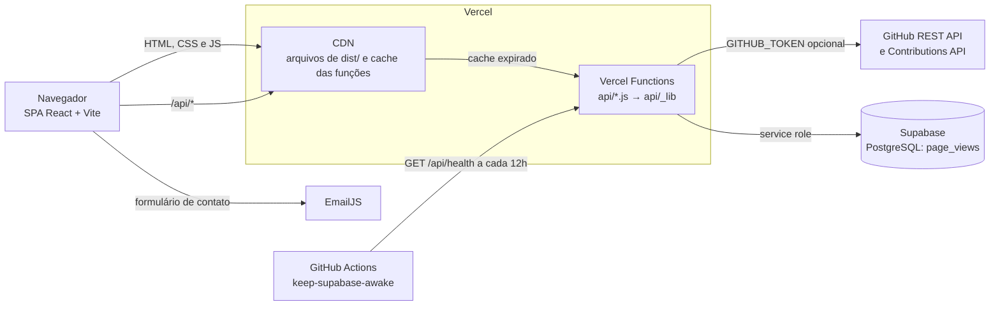
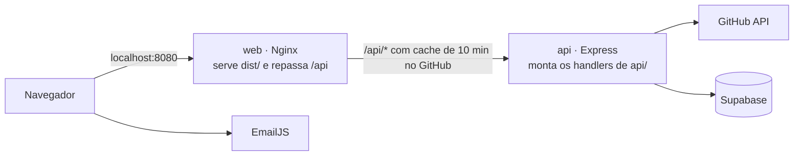
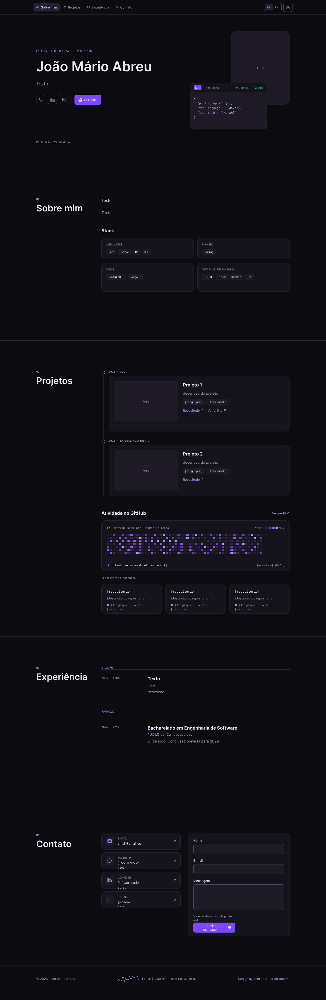
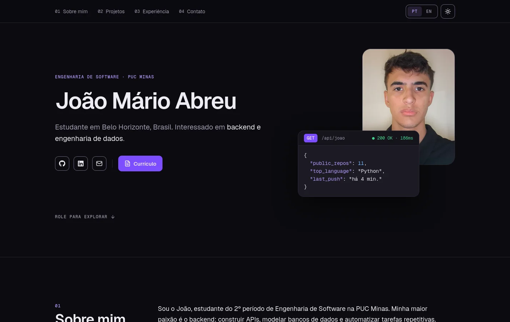
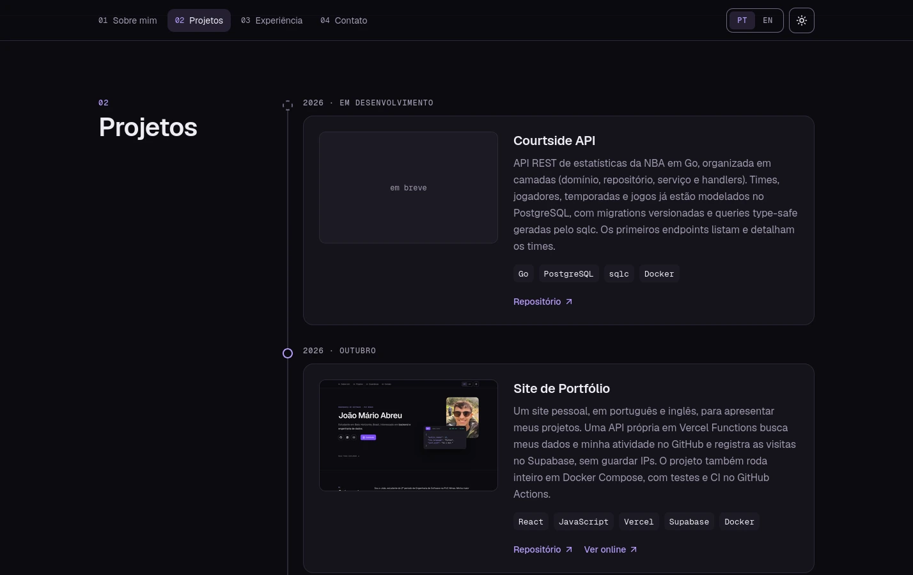
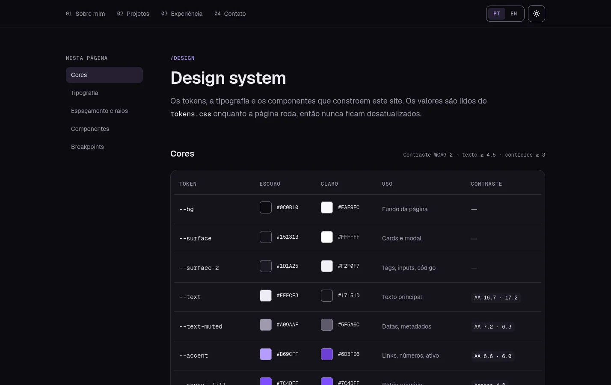
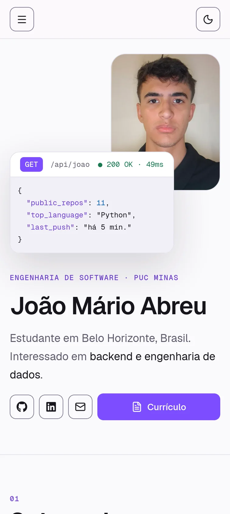
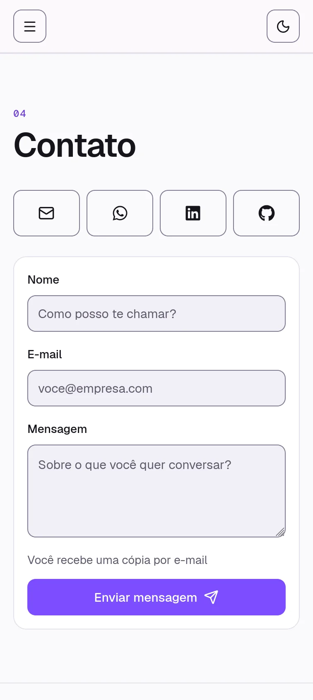

# 💼 Portfólio

<table>
  <tr>
    <td width="800px">
      <div align="justify">
        Este é o meu <b>portfólio pessoal</b>. A página única apresenta quem eu sou, minha stack, meus projetos, minha experiência e um formulário de contato. Os dados do GitHub, o contador de visitas e o card de API do topo vêm de <b>funções serverless próprias</b> na Vercel, com o banco no <b>Supabase</b>. O site funciona em <i>dois idiomas</i> e <i>dois temas</i>, segue um <b>design system</b> próprio, publicado na rota <code>/design</code>, e também roda inteiro em <b>Docker Compose</b>.
      </div>
    </td>
  </tr>
</table>

---

## 🚧 Status do Projeto

[](https://github.com/joaom-abreu/portfolio/actions/workflows/ci.yml)
[](https://github.com/joaom-abreu/portfolio/releases)
[](#-licença)
[](https://www.joaomario.dev)

        

---

## 📚 Índice

- [Links Úteis](#-links-úteis)
- [Sobre o Projeto](#-sobre-o-projeto)
- [Funcionalidades Principais](#-funcionalidades-principais)
- [Tecnologias Utilizadas](#-tecnologias-utilizadas)
- [Arquitetura](#-arquitetura)
  - [Visão geral em produção](#visão-geral-em-produção)
  - [Execução com Docker Compose](#execução-com-docker-compose)
  - [Endpoints da API](#endpoints-da-api)
- [Instalação e Execução](#-instalação-e-execução)
  - [Pré-requisitos](#pré-requisitos)
  - [Variáveis de Ambiente](#-variáveis-de-ambiente)
  - [Instalação de Dependências](#-instalação-de-dependências)
  - [Inicialização do Banco de Dados (Supabase)](#-inicialização-do-banco-de-dados-supabase)
  - [Como Executar a Aplicação](#-como-executar-a-aplicação)
- [Deploy](#-deploy)
- [Estrutura de Pastas](#-estrutura-de-pastas)
- [Demonstração](#-demonstração)
  - [Wireframe](#-wireframe)
  - [Aplicação Web](#-aplicação-web)
  - [Exemplo de saída no Terminal (API)](#-exemplo-de-saída-no-terminal-api)
- [Testes](#-testes)
- [Documentações utilizadas](#-documentações-utilizadas)
- [Autor](#-autor)
- [Licença](#-licença)

---

## 🔗 Links Úteis

- 🌐 **Site publicado:** [joaomario.dev](https://www.joaomario.dev)
  > 💻 Produção na Vercel, publicada a cada push na `main`.
- 🎨 **Design system:** [joaomario.dev/design](https://www.joaomario.dev/design)
  > 🧩 Cores dos dois temas com contraste WCAG, tipografia, espaçamento, raios, componentes e breakpoints, lidos do próprio CSS.
- 🖼️ **Protótipo no Figma:** [abrir o arquivo do portfólio](https://www.figma.com/design/CZNCwLiWEEIQhAxpMmIzC2/portfolio)
  > ✏️ Wireframes de média fidelidade usados como referência visual.
- 🩺 **Status da API:** [joaomario.dev/api/health](https://www.joaomario.dev/api/health)
  > 📡 Responde `{ "status": "ok" }` quando a função e o banco estão no ar.

---

## 📝 Sobre o Projeto

O portfólio nasceu como o LAB01 de DIAW, na PUC Minas, mas foi pensado para ser usado de verdade: é o link que eu mando em processos seletivos de estágio. Ele resolve um problema simples, que é mostrar em uma página **quem eu sou, o que eu já construí e como falar comigo**, sem depender de um currículo estático que fica desatualizado.

O que o diferencia de uma página estática:

- **Dados ao vivo:** o card de API do topo, a atividade no GitHub e os repositórios recentes vêm de funções serverless próprias, que consultam a API do GitHub e guardam o resultado no cache da CDN.
- **Back-end de verdade:** o contador de visitas grava no Supabase (PostgreSQL) um hash diário do visitante, sem salvar o IP, e o navegador nunca acessa o banco diretamente.
- **Bilíngue e acessível:** português e inglês no site inteiro, tema claro e escuro, navegação por teclado com foco sempre visível e contraste conferido pelas regras da WCAG.
- **Dois jeitos de rodar:** a produção fica na Vercel, e o projeto inteiro também sobe com um comando no Docker Compose (Nginx + Express), usando as mesmas funções.

Como o foco dos meus estudos é **back-end e engenharia de dados**, o portfólio também serve de exemplo prático disso: API própria com contrato definido, testes das regras de negócio, migration versionada, CI e containers.

---

## ✨ Funcionalidades Principais

- 🧭 **Navegação por seções:** Sobre mim, Projetos, Experiência e Contato em uma página única, com destaque da seção atual no menu e menu próprio no celular.
- 🌗 **Tema claro e escuro:** segue a preferência do sistema e guarda a escolha no navegador.
- 🌐 **Internacionalização (i18n):** site inteiro em português e inglês, com `?lang=en` na URL, título e descrição da página no idioma escolhido.
- 🪪 **Hero com card de API:** foto, redes e um card que mostra a resposta ao vivo do `GET /api/joao`, com tempo de resposta e estados de carregamento e erro.
- 🗓️ **Linha do tempo de projetos:** do mais antigo ao mais recente, com imagem, tags, link do repositório e do site publicado.
- 📈 **Atividade no GitHub:** calendário de contribuições dos últimos 12 meses, último commit e os três repositórios com push mais recente.
- 🎓 **Experiência e formação:** atuação e formação acadêmica.
- 📨 **Contato:** links diretos (e-mail, WhatsApp, LinkedIn e GitHub) e formulário com validação por campo, com envio por e-mail e cópia para quem escreveu.
- 📄 **Currículo em PDF:** leitura em um modal, em português e inglês, com download; no celular abre em nova aba.
- 👀 **Contador de visitas:** total e gráfico dos últimos 30 dias no rodapé, sem guardar o IP de quem visita.
- 🎨 **Página do design system:** rota `/design` com cores, tipografia, espaçamento, raios, componentes e breakpoints.
- 📱 **Layout responsivo e acessível:** do celular ao desktop, com navegação por teclado, foco sempre visível e respeito a `prefers-reduced-motion`.
- 🔎 **SEO e desempenho:** meta tags, Open Graph, URL canônica por rota e Lighthouse de 97 a 100 nas quatro categorias na página inicial em produção, no celular e no desktop.

---

## 🛠 Tecnologias Utilizadas

As versões abaixo são as do `package.json` e do `.nvmrc`. Recomenda-se usar as mesmas versões principais.

### 💻 Front-end

- **Framework/Biblioteca:** React 19
- **Linguagem:** JavaScript (ES modules)
- **Build Tool:** Vite 8
- **Rotas:** React Router 7 (`/` e `/design`)
- **Estilização:** CSS Modules com design tokens em variáveis CSS (`src/styles/tokens.css`) e troca de tema por `data-theme`
- **Gerenciamento de Estado:** hooks do React e Context API (tema)
- **Internacionalização:** i18next e react-i18next
- **Formulário e e-mail:** React Hook Form e EmailJS
- **Ícones:** Lucide e React Icons
- **Fontes:** Geist e Geist Mono servidas pelo próprio site (licença OFL)

### 🖥️ Back-end

- **Linguagem/Runtime:** Node.js 22
- **API:** Vercel Functions (`api/`)
- **Banco de Dados:** Supabase (PostgreSQL) com `@supabase/supabase-js`
- **Integrações:** GitHub REST API e GitHub Contributions API
- **Servidor no Docker:** Express 5, que só monta os mesmos handlers de `api/`
- **Testes:** Vitest

### ⚙️ Infraestrutura & DevOps

- **Cloud:** Vercel (front, funções e CDN) com o domínio `joaomario.dev`
- **Containerização:** Docker e Docker Compose v2, com Nginx (alpine) servindo o front e Node (alpine) rodando a API
- **CI/CD:** GitHub Actions (lint, testes, build e build das imagens Docker a cada push e PR) e deploy contínuo da Vercel
- **Agendamento:** GitHub Actions chamando `/api/health` a cada 12 horas para o Supabase não pausar o projeto
- **Qualidade de código:** ESLint e Prettier

---

## 🏗 Arquitetura

O projeto é um **monólito modular** dividido em duas partes que só conversam por HTTP: o **front-end** (SPA em React) e o **back-end** (funções serverless em `api/`). A escolha por funções serverless em vez de um servidor próprio vem do tamanho do problema: quatro endpoints de leitura e um de escrita, sem sessão nem login. Com isso, o deploy fica no mesmo lugar do front e o cache fica com a CDN da Vercel.

**Front-end (`src/`), em camadas:**

- **`app/`:** ponto de montagem: rotas, i18n, provedor de tema e metadados da página.
- **`pages/`, `sections/` e `layout/`:** páginas, seções da página principal e o esqueleto (cabeçalho, menu mobile, rodapé, seção).
- **`shared/ui/`:** componentes do design system (Button, Tag, Modal, TextField, Skeleton, Sparkline...), cada um com seu CSS Module.
- **`shared/services/`:** **única porta de saída** do front. A interface nunca chama uma API externa diretamente: tudo passa por `apiClient.js`, `portfolioApi.js` e `emailService.js`.
- **`shared/hooks/` e `shared/lib/`:** comportamento reutilizável (`useApi`, `useScrollSpy`, `useTheme`...) e funções puras (`formatRelativeTime`, `contrastRatio`...).
- **`data/` e `locales/`:** conteúdo (perfil, projetos, experiências, contatos) com campos `pt` e `en`, e os textos fixos da interface.

**Back-end (`api/`), com handlers finos:**

- **`api/*.js`:** cada handler só valida o método, chama um serviço e responde. Eles usam apenas `req.method`, `req.headers`, `req.query`, `req.body`, `res.status`, `res.setHeader`, `res.json` e `res.end`, que existem tanto na Vercel quanto no Express.
- **`api/_lib/`:** as regras ficam aqui, separadas por assunto: `github/` (cliente, mapeamento e agregações), `views/` (hash do visitante, repositório e serviço), `supabase/` (cliente e checagem de saúde), `http/` (respostas, erros, cache e fetch com timeout) e `config/` (leitura das variáveis). O `_` no nome impede a Vercel de transformar a pasta em rota.
- **`server/`:** só existe para o Docker. Monta os handlers de `api/` no Express, sem nenhuma regra própria.

**Decisões e trade-offs:**

- **Segredos só no servidor:** a chave do Supabase, o token do GitHub e o sal das visitas não têm prefixo `VITE_` e só são lidos em `api/`. O navegador nunca fala com o Supabase.
- **Cache na borda:** as respostas do GitHub saem com `s-maxage=600, stale-while-revalidate=86400`, então a maioria das visitas nem chega à função e o limite da API do GitHub é respeitado. No Docker, o Nginx faz esse papel com `proxy_cache` de 10 minutos.
- **Privacidade:** a visita é contada por `sha256(ip + user-agent + sal + dia)`. O IP nunca é salvo, e o hash muda todo dia.
- **Falha graciosa:** erros voltam como `{ "error": "<codigo>" }` com o status certo, e só o bloco afetado muda: o card de API aparece como offline, a atividade e os repositórios viram um link para o GitHub e o contador de visitas some. O resto da página continua funcionando.
- **Sem bibliotecas de UI:** o design system já existe em tokens CSS, então o bundle fica pequeno e o visual fica sob controle.
- **E-mail pelo navegador:** o EmailJS é a única integração que não passa por `api/`. Ele é chamado pelo `emailService.js` com a chave pública, que é o uso previsto pelo serviço.

### Visão geral em produção



### Execução com Docker Compose



### Endpoints da API

| Endpoint                   | Fontes                                            | Cache                                        | Usado por                                   |
| -------------------------- | ------------------------------------------------- | -------------------------------------------- | ------------------------------------------- |
| `GET /api/joao`            | GitHub: perfil e repositórios                     | `s-maxage=600, stale-while-revalidate=86400` | Card de API do hero                         |
| `GET /api/github-activity` | GitHub Contributions API + repositórios e commits | `s-maxage=600, stale-while-revalidate=86400` | Atividade no GitHub e repositórios recentes |
| `POST /api/views`          | Supabase (`page_views`)                           | `no-store`                                   | Registro da visita ao abrir o site          |
| `GET /api/views`           | Supabase (`daily_views`)                          | `s-maxage=300`                               | Contador do rodapé                          |
| `GET /api/health`          | Supabase (consulta mínima)                        | `no-store`                                   | GitHub Action que mantém o projeto ativo    |

---

## 🔧 Instalação e Execução

### Pré-requisitos

- **Node.js:** versão **22** (a mesma do `.nvmrc`; com o nvm, basta `nvm use`)
- **Gerenciador de Pacotes:** npm
- **Docker Engine com Docker Compose v2** (ou `podman compose`) para rodar com containers
- **Vercel CLI** (opcional), para rodar com `vercel dev`: `npm install -g vercel`
- **Contas nos serviços:** [Supabase](https://supabase.com) (contador de visitas) e [EmailJS](https://www.emailjs.com) (formulário). Um token do GitHub é opcional.

---

### 🔑 Variáveis de Ambiente

Copie o modelo e preencha os valores:

```bash
cp .env.example .env.local
```

As variáveis com `VITE_` vão para o navegador e só podem ser chaves públicas; as demais ficam só nas funções de `api/`.

| Variável                              | Lado                                     | Descrição                                                         | Onde conseguir                                                   |
| ------------------------------------- | ---------------------------------------- | ----------------------------------------------------------------- | ---------------------------------------------------------------- |
| `VITE_EMAILJS_SERVICE_ID`             | Navegador                                | Serviço de e-mail do formulário                                   | EmailJS → Email Services                                         |
| `VITE_EMAILJS_TEMPLATE_ID_FOR_ME`     | Navegador                                | Template da mensagem que chega para mim                           | EmailJS → Email Templates                                        |
| `VITE_EMAILJS_TEMPLATE_ID_FOR_SENDER` | Navegador                                | Template da confirmação para quem escreveu                        | EmailJS → Email Templates                                        |
| `VITE_EMAILJS_PUBLIC_KEY`             | Navegador                                | Chave pública do EmailJS                                          | EmailJS → Account                                                |
| `GITHUB_TOKEN`                        | Servidor (opcional)                      | Sobe o limite da API do GitHub de 60 para 5.000 chamadas por hora | GitHub → token fine-grained, só leitura de repositórios públicos |
| `SUPABASE_URL`                        | Servidor                                 | Endereço do projeto Supabase                                      | Supabase → Project Settings → API                                |
| `SUPABASE_SERVICE_ROLE_KEY`           | Servidor (secreta)                       | Acesso à tabela de visitas, ignorando o RLS                       | Supabase → Project Settings → API (`service_role` ou secret key) |
| `VIEWS_SALT`                          | Servidor (secreta)                       | Sal do hash diário dos visitantes                                 | `openssl rand -hex 32`                                           |
| `SITE_URL`                            | GitHub Actions (variável do repositório) | Endereço que o Action chama em `/api/health`                      | URL de produção (`https://joaomario.dev`)                        |

Na Vercel, cadastre as oito primeiras em **Project Settings → Environment Variables** (Production e Preview). Com o projeto ligado pela CLI, `vercel env pull .env.local` traz todas para a máquina. A `SITE_URL` fica em **Settings → Secrets and variables → Actions → Variables** do repositório no GitHub.

> [!IMPORTANT]
> O `.env.local` está no `.gitignore` e o `.dockerignore` exclui `.env*`, então nenhum segredo vai para o Git nem para dentro das imagens.

---

### 📦 Instalação de Dependências

1. **Clone o repositório:**

```bash
git clone https://github.com/joaom-abreu/portfolio.git
cd portfolio
```

2. **Instale as dependências** (front e back-end ficam no mesmo `package.json`):

```bash
npm install
```

---

### 💾 Inicialização do Banco de Dados (Supabase)

O contador de visitas usa uma tabela no Supabase. O navegador nunca acessa o banco: só as funções de `api/` leem e gravam, com a chave de servidor.

1. Crie um projeto em [supabase.com](https://supabase.com). Escolha a região mais próxima das funções da Vercel (por padrão, Leste dos EUA).
2. No painel do projeto, abra o **SQL Editor**, cole o conteúdo de [`db/migrations/001_page_views.sql`](./db/migrations/001_page_views.sql) e clique em **Run**. O arquivo pode ser executado mais de uma vez.
3. Confira o resultado rodando `select * from public.daily_views(7);`. Devem voltar 7 linhas, uma por dia, com `views` igual a 0.
4. Em **Project Settings → API**, copie o endereço do projeto e a chave de servidor (`service_role` ou secret key).
5. Gere o sal do hash dos visitantes com `openssl rand -hex 32`.
6. Preencha `SUPABASE_URL`, `SUPABASE_SERVICE_ROLE_KEY` e `VIEWS_SALT` no `.env.local` e na Vercel.

> [!IMPORTANT]
> A chave de servidor ignora o RLS e dá acesso total ao banco. Ela nunca recebe o prefixo `VITE_`, nunca vai para o Git e só é lida em `api/`.

**O que a migration cria:**

- **`page_views`:** uma linha por visitante por dia, com a data e um hash. O IP não é salvo.
- **RLS ligado e sem políticas:** a chave pública do Supabase não lê nem grava nada na tabela.
- **`daily_views(days)`:** função que devolve as visitas dos últimos dias, com zero nos dias sem visita.

---

### ⚡ Como Executar a Aplicação

Há três formas de rodar o projeto localmente.

#### Opção 1: Vercel CLI (front e funções juntos)

É a forma mais próxima da produção. Na primeira vez, ligue a pasta ao projeto da Vercel e traga as variáveis:

```bash
vercel link
vercel env pull .env.local
vercel dev
```

🚀 _O site e a API ficam em **http://localhost:3000**._

#### Opção 2: só o front-end (Vite)

```bash
npm run dev
```

🎨 _O front fica em **http://localhost:5173**. Sem as funções, os blocos que dependem de `/api` mostram o estado de erro: o card de API aparece como offline, a atividade no GitHub vira um link para o perfil e o contador de visitas some._

#### 🐳 Opção 3: Docker Compose (projeto completo)

O Compose sobe dois serviços: o **`web`** (Nginx servindo o build e repassando `/api/*`) e o **`api`** (Express com os handlers de `api/`, visível só na rede interna). O banco continua no Supabase e o e-mail no EmailJS, com as mesmas variáveis do `.env.local`.

Antes de tudo, confira se o serviço do Docker está em execução. No Linux:

```bash
sudo systemctl start docker
```

1. Na raiz do projeto, com o `.env.local` preenchido, construa as imagens e suba os containers:

```bash
npm run docker:up
```

> [!NOTE]
> 💡 O script roda `docker compose --env-file .env.local up --build -d`. As variáveis `VITE_*` entram como build args do front; as do servidor só chegam ao container `api` em tempo de execução, pelo `env_file`.

2. Verifique se os containers estão rodando (o `api` deve aparecer como `healthy`):

```bash
docker compose ps
```

3. Abra **http://localhost:8080** no navegador.

4. Para acompanhar os logs e para derrubar tudo:

```bash
npm run docker:logs
npm run docker:down
```

**Modo desenvolvimento no Docker:** `npm run docker:dev` sobe a API com `node --watch` e o Vite em **http://localhost:5173**, com recarga ao salvar. No Fedora, as pastas montadas já levam `:z` por causa do SELinux.

| Script                | O que faz                                                 |
| --------------------- | --------------------------------------------------------- |
| `npm run dev`         | Vite em modo desenvolvimento                              |
| `npm run build`       | Build de produção em `dist/`                              |
| `npm run preview`     | Serve o build localmente                                  |
| `npm run lint`        | ESLint no projeto inteiro                                 |
| `npm run format`      | Prettier no projeto inteiro                               |
| `npm test`            | Testes com Vitest                                         |
| `npm run docker:up`   | Constrói as imagens e sobe `web` e `api` em segundo plano |
| `npm run docker:dev`  | Sobe `api` com `node --watch` e `vite` com recarga        |
| `npm run docker:logs` | Acompanha os logs dos containers                          |
| `npm run docker:down` | Derruba os containers                                     |

---

## 🚀 Deploy

A produção fica na **Vercel**, ligada a este repositório do GitHub.

1. **Importe o repositório** na Vercel. O preset do Vite é detectado sozinho (build `npm run build`, saída `dist/`), e cada arquivo de `api/` vira uma Vercel Function.
2. **Cadastre as variáveis de ambiente** da tabela acima em Production e Preview.
3. **Publique:** cada push na `main` gera um deploy de produção, e cada pull request ganha uma URL de preview.

O `vercel.json` faz o fallback da SPA (toda rota fora de `/api/` cai no `index.html`, para o `/design` funcionar ao recarregar) e dá cache de um ano às fontes. O domínio `joaomario.dev` aponta para o projeto e redireciona para `www.joaomario.dev`.

Antes do deploy, o workflow **CI** (`.github/workflows/ci.yml`) roda lint, testes, build e o build das imagens `web` e `api` em todo push e pull request. O workflow **keep-supabase-awake** chama `$SITE_URL/api/health` a cada 12 horas, porque o Supabase pausa projetos gratuitos parados.

Para rodar a versão de produção fora da Vercel, use a [Opção 3](#-opção-3-docker-compose-projeto-completo): o `Dockerfile` gera uma imagem Nginx com o build e outra Node com a API, prontas para qualquer servidor com Docker.

---

## 📂 Estrutura de Pastas

```
.
├── .github/workflows/
│   ├── ci.yml                  # 🤖 Lint, testes, build e imagens Docker em push e PR.
│   └── keep-supabase-awake.yml # ⏰ Chama /api/health a cada 12 horas.
├── api/                        # 🖥️ Vercel Functions: handlers finos, um por endpoint.
│   ├── joao.js                 # 🪪 GET /api/joao
│   ├── github-activity.js      # 📈 GET /api/github-activity
│   ├── views.js                # 👀 GET e POST /api/views
│   ├── health.js               # 🩺 GET /api/health
│   └── _lib/                   # ⚙️ Regras de negócio (a Vercel não vira rota com "_").
│       ├── config/             # 🔧 Leitura das variáveis de ambiente.
│       ├── github/             # 🐙 Cliente do GitHub, mapeamentos e agregações.
│       ├── http/               # 🌐 Respostas, erros, cache e fetch com timeout.
│       ├── supabase/           # 🗄️ Cliente do Supabase e checagem de saúde.
│       └── views/              # 🔢 Hash do visitante, repositório e serviço de visitas.
├── db/migrations/              # 📜 SQL versionado do banco (001_page_views.sql).
├── docker/nginx.conf           # 🧭 Nginx: SPA, proxy de /api e cache.
├── docs/
│   ├── og-image/               # 🖼️ Página que gera a imagem de Open Graph.
│   ├── screenshots/            # 📸 Capturas do site usadas neste README.
│   └── wireframes/             # 🖼️ Wireframe de referência (wireframe.png).
├── public/
│   ├── cv/                     # 📄 Currículo em PDF (pt e en).
│   ├── fonts/                  # ✒️ Geist e Geist Mono (woff2) e a licença OFL.
│   ├── images/                 # 🖼️ Foto e imagem de Open Graph.
│   ├── projects/               # 🗂️ Imagens dos projetos.
│   └── robots.txt              # 🤖 Regras para robôs de busca.
├── server/                     # 🐳 Express que só monta os handlers de api/ no Docker.
│   ├── app.js
│   └── index.js
├── src/
│   ├── main.jsx                # 🚪 Ponto de entrada do React.
│   ├── app/                    # 🧱 App, rotas, i18n, tema e metadados da página.
│   ├── pages/                  # 📄 HomePage e DesignPage (/design).
│   ├── layout/                 # 🧩 Header, MobileMenu, Footer, Section e afins.
│   ├── sections/               # 🧭 Hero, About, Projects, Experience e Contact.
│   ├── shared/
│   │   ├── ui/                 # 🎛️ Componentes do design system.
│   │   ├── hooks/              # 🎣 Hooks (useApi, useTheme, useScrollSpy...).
│   │   ├── services/           # 🔌 Única saída para APIs (apiClient, portfolioApi, emailService).
│   │   └── lib/                # 🛠️ Funções puras e utilitárias.
│   ├── data/                   # 🗃️ Conteúdo do site em pt e en.
│   ├── locales/                # 🌎 Textos da interface (pt.json e en.json).
│   └── styles/                 # 🎨 tokens.css, base.css e fonts.css.
├── .dockerignore               # 🐳 Mantém .env* e node_modules fora das imagens.
├── .editorconfig               # ✍️ Padronização de estilo de código.
├── .env.example                # 🧩 Todas as variáveis necessárias, sem valores.
├── .gitignore                  # 🧹 Arquivos e pastas não versionados.
├── .nvmrc                      # 🟢 Versão do Node.js (22).
├── .prettierignore             # 🎨 Arquivos que o Prettier não formata.
├── .prettierrc.json            # 🎨 Configuração do Prettier.
├── compose.yaml                # 🐳 Serviços web e api.
├── compose.dev.yaml            # 🐳 Modo desenvolvimento (Vite e node --watch).
├── Dockerfile                  # 🐳 Estágios deps, build, web e api.
├── eslint.config.js            # ✨ Regras do ESLint.
├── index.html                  # 📄 HTML de entrada, meta tags e Open Graph.
├── LICENSE                     # ⚖️ Licença MIT.
├── package.json                # 📦 Dependências e scripts.
├── package-lock.json           # 🔒 Lockfile das dependências.
├── README.md                   # 📘 Esta documentação.
├── vercel.json                 # ▲ Fallback da SPA e cache das fontes na Vercel.
└── vite.config.js              # ⚡ Vite, alias @ e configuração dos testes.
```

Cada componente é uma pasta com `Nome.jsx` e `Nome.module.css`, e os testes ficam ao lado do arquivo testado.

### 🖼️ Imagem de Open Graph

A imagem que aparece ao compartilhar o link (`public/images/og-image.png`, 1200×630) é gerada pela página em [`docs/og-image/`](./docs/og-image). Ela usa os mesmos tokens, fontes e componentes do site e lê o eyebrow, o nome e a frase de `src/data/profile.js`, então acompanha qualquer mudança no hero. Ela não entra no build.

1. Rode `npm run dev` e abra **http://localhost:5173/docs/og-image/**.
2. Capture o elemento `<main>` (1200×630) com a ferramenta de captura do navegador. No Firefox, use **Ctrl+Shift+S**; no Chrome, abra o DevTools, selecione o `<main>` e use **Capture node screenshot**.
3. Salve como `public/images/og-image.png`. Se o texto mudar, atualize também o `og:image:alt` do `index.html`.

---

## 🎥 Demonstração

### 🎨 Wireframe

Wireframe da página principal no desktop, feito no [Figma](https://www.figma.com/design/CZNCwLiWEEIQhAxpMmIzC2/portfolio) antes da implementação. Ele define composição, ordem e hierarquia; os textos entre colchetes e os espaços de foto são placeholders.

<p align="center">
  
</p>

### 🌐 Aplicação Web

Capturas do site publicado em [joaomario.dev](https://www.joaomario.dev).

|                                                                   Página inicial · desktop · tema escuro                                                                    |                                                                                                                              Projetos · desktop · tema escuro                                                                                                                               |
| :-------------------------------------------------------------------------------------------------------------------------------------------------------------------------: | :-----------------------------------------------------------------------------------------------------------------------------------------------------------------------------------------------------------------------------------------------------------------------------------------: |
|          |                                                                                                                        |
|                                                            **Design system (`/design`) · desktop · tema escuro**                                                            |                                                                                                                     **Página inicial e contato · celular · tema claro**                                                                                                                     |
|  |   |

### 💻 Exemplo de Saída no Terminal (API)

#### 1. Resumo do perfil no GitHub

Chama o endpoint que alimenta o card de API do hero.

```bash
curl https://www.joaomario.dev/api/joao
```

**Saída Esperada:**

```json
{
  "public_repos": 11,
  "top_language": "Python",
  "last_push": "2026-10-14T17:12:44Z"
}
```

#### 2. Contador de visitas

Devolve o total e os últimos 30 dias, com zero nos dias sem visita. A lista abaixo foi encurtada para os três últimos dias.

```bash
curl https://www.joaomario.dev/api/views
```

**Saída Esperada:**

```json
{
  "total": 22,
  "daily": [
    { "date": "2026-10-12", "count": 0 },
    { "date": "2026-10-13", "count": 0 },
    { "date": "2026-10-14", "count": 22 }
  ]
}
```

#### 3. Saúde da API e do banco

```bash
curl https://www.joaomario.dev/api/health
```

**Saída Esperada:**

```json
{ "status": "ok" }
```

Se o banco estiver fora do ar ou a chave for inválida, a resposta é `503` com `{ "error": "database_unavailable" }`.

---

## 🧪 Testes

### Testes Unitários

Os testes cobrem as regras de negócio do back-end e as funções puras do front:

- **`api/_lib/github/`:** resumo do perfil (linguagem mais usada, último push), calendário de contribuições, último commit e repositórios recentes.
- **`api/_lib/views/`:** hash diário do visitante, data em UTC e preenchimento dos dias sem visita.
- **`src/`:** tempo relativo ("há 5 min."), contraste WCAG, cores hexadecimais, sparkline, semanas do calendário, tipo de mídia dos projetos, URL canônica e sincronia das meta tags com o `pt.json`.

```bash
npm test
```

**Saída Esperada:**

```text
 Test Files  15 passed (15)
      Tests  112 passed (112)
```

_Ferramenta utilizada: Vitest._

### Qualidade e CI

```bash
npm run lint
npm run build
```

O workflow de CI roda lint, testes e build a cada push e pull request, e também constrói as imagens Docker `web` e `api`. Não há testes end-to-end; a interface foi conferida no navegador em 1440px e 390px, nos dois temas, e auditada com o Lighthouse.

---

## 🔗 Documentações utilizadas

- 📖 **Biblioteca (Front-end):** [Documentação oficial do **React**](https://react.dev/reference/react)
- 📖 **Build Tool (Front-end):** [Guia de configuração do **Vite**](https://vite.dev/config/)
- 📖 **Rotas:** [Documentação do **React Router**](https://reactrouter.com/)
- 📖 **Internacionalização:** [**i18next**](https://www.i18next.com/) e [**react-i18next**](https://react.i18next.com/)
- 📖 **Formulário:** [Documentação do **React Hook Form**](https://react-hook-form.com/docs)
- 📖 **E-mail:** [SDK do **EmailJS** para navegador](https://www.emailjs.com/docs/sdk/installation/)
- 📖 **Back-end:** [**Vercel Functions** com Node.js](https://vercel.com/docs/functions/runtimes/node-js)
- 📖 **Banco de Dados:** [**Supabase** JavaScript](https://supabase.com/docs/reference/javascript/introduction) e [Row Level Security](https://supabase.com/docs/guides/database/postgres/row-level-security)
- 📖 **Integração:** [**GitHub REST API**](https://docs.github.com/en/rest) e [GitHub Contributions API](https://github.com/grubersjoe/github-contributions-api)
- 📖 **Testes:** [Guia do **Vitest**](https://vitest.dev/guide/)
- 📖 **Containerização:** [Documentação do **Docker**](https://docs.docker.com/), [**Docker Compose**](https://docs.docker.com/compose/) e [**Nginx**](https://nginx.org/en/docs/)
- 📖 **Servidor no Docker:** [**Express** 5](https://expressjs.com/en/5x/api.html)
- 📖 **CI/CD:** [**GitHub Actions**](https://docs.github.com/en/actions)
- 📖 **Acessibilidade:** [**WCAG 2.2**](https://www.w3.org/TR/WCAG22/) e [contraste mínimo](https://www.w3.org/WAI/WCAG22/Understanding/contrast-minimum.html)
- 📖 **Design system:** [joaomario.dev/design](https://www.joaomario.dev/design), gerado a partir de `src/styles/tokens.css`

---

## 👤 Autor

| 👤 Nome          |                                      🖼️ Foto                                       |                                                                   :octocat: GitHub                                                                    |                                                                               💼 LinkedIn                                                                               |                                                                     📤 Gmail                                                                      |
| ---------------- | :--------------------------------------------------------------------------------: | :---------------------------------------------------------------------------------------------------------------------------------------------------: | :---------------------------------------------------------------------------------------------------------------------------------------------------------------------: | :-----------------------------------------------------------------------------------------------------------------------------------------------: |
| João Mário Abreu |  | <a href="https://github.com/joaom-abreu"></a> | <a href="https://www.linkedin.com/in/joao-mario-abreu"></a> | <a href="mailto:abreujoaomr@gmail.com"></a> |

---

## 📄 Licença

Este projeto é distribuído sob a **[Licença MIT](./LICENSE)**.

As fontes Geist e Geist Mono, em `public/fonts/`, seguem a [SIL Open Font License](./public/fonts/OFL.txt).

---
