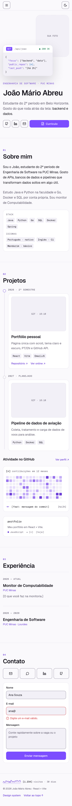
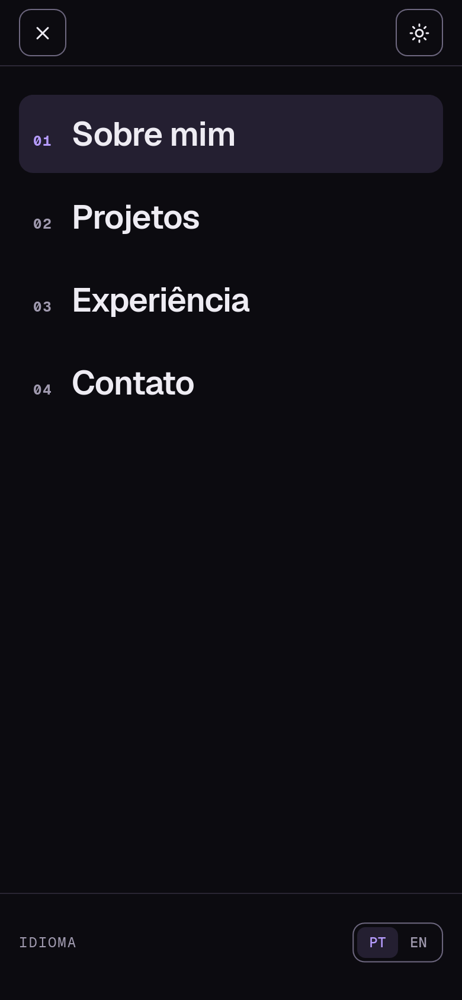
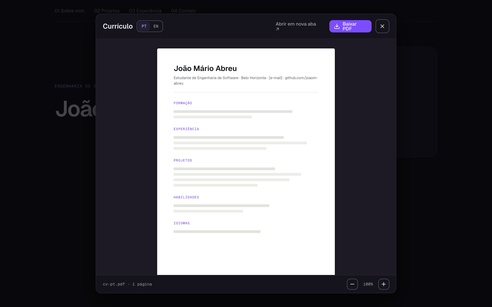
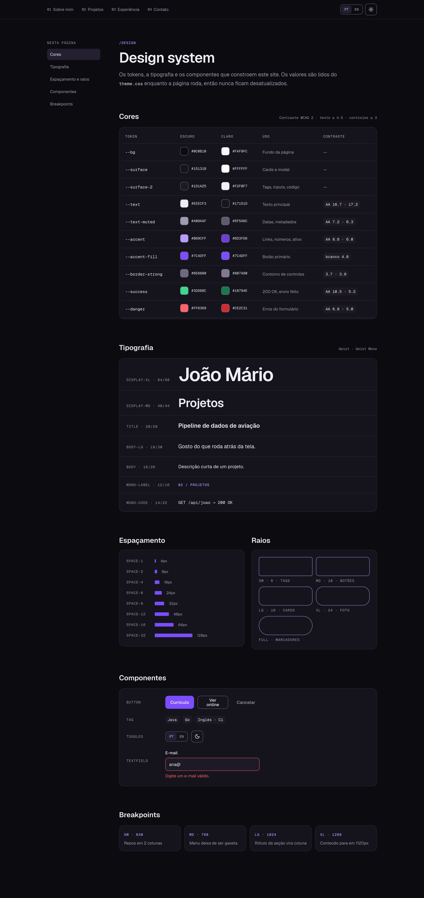

# 💼 Portfólio · João Mário Abreu

> [!NOTE]
> Portfólio pessoal de João Mário Abreu, estudante de Engenharia de Software na PUC Minas com foco em backend e dados. Uma página única, em português e inglês, que reúne projetos, experiência e formas de contato.

> [!WARNING]
> 🚧 Projeto em construção. Este README descreve o que está planejado e é atualizado a cada etapa.

---

## 📝 Sobre o Projeto

Este repositório guarda o portfólio pessoal de João Mário Abreu. Ele nasceu como o **LAB01 da disciplina DIAW**, na PUC Minas, e segue como projeto pessoal depois da entrega.

- **Por que ele existe:** para apresentar em um só lugar quem é o João, o que ele já construiu e como falar com ele, com o primeiro estágio como próximo passo.
- **Qual problema ele resolve:** o currículo em PDF e o perfil do GitHub mostram cada um só uma parte da história. O portfólio junta os projetos em uma linha do tempo, a atividade real no GitHub, a formação e o contato.
- **Qual o contexto:** acadêmico, como laboratório da disciplina, e pessoal, como vitrine profissional.
- **O que o torna interessante:** além da interface, o projeto tem backend próprio. Os dados do GitHub e o contador de visitas passam por uma API do próprio portfólio, e a aplicação inteira também roda em Docker Compose.

---

## ✨ Funcionalidades Previstas

- 🧭 **Navegação por seções:** Sobre mim, Projetos, Experiência e Contato em uma página única, com destaque da seção atual no menu.
- 🌗 **Tema claro e escuro:** segue a preferência do sistema e guarda a escolha no navegador.
- 🌐 **Internacionalização (i18n):** site inteiro em português e inglês, com `?lang=en` na URL.
- 🪪 **Hero com card de API:** foto, redes e um card que consome a API do próprio portfólio.
- 🗓️ **Linha do tempo de projetos:** do mais antigo ao mais recente, com mídia, tags e links.
- 📈 **Atividade no GitHub:** calendário de contribuições, último commit e repositórios recentes.
- 🎓 **Experiência e formação:** atuação, formação e o próximo capítulo.
- 📨 **Contato:** links diretos e formulário com validação, com envio por e-mail e cópia para quem escreveu.
- 📄 **Currículo em PDF:** leitura em um modal, em português e inglês, com download.
- 👀 **Contador de visitas:** total e últimos 30 dias no rodapé, sem guardar o IP de quem visita.
- 🎨 **Página do design system:** rota `/design` com cores, tipografia, espaçamento e componentes.
- 📱 **Layout responsivo e acessível:** do celular ao desktop, com navegação por teclado e foco sempre visível.

---

## 🛠 Tecnologias Previstas

React, Vite, ESLint e Prettier já estão instalados. As demais tecnologias entram nas próximas etapas.

### 💻 Front-end

- **Framework/Biblioteca:** React 19
- **Linguagem:** JavaScript
- **Build Tool:** Vite 8
- **Rotas:** React Router
- **Estilização:** CSS Modules com design tokens em variáveis CSS
- **Internacionalização:** i18next e react-i18next
- **Formulário e e-mail:** React Hook Form e EmailJS
- **Ícones:** Lucide e React Icons
- **Qualidade de código:** ESLint e Prettier

### 🖥️ Back-end

- **Linguagem/Runtime:** Node.js 22
- **API:** Vercel Functions
- **Banco de Dados:** Supabase (PostgreSQL)
- **Integrações:** GitHub API
- **Testes:** Vitest

### ⚙️ Infraestrutura & DevOps

- **Cloud:** Vercel
- **Containerização:** Docker e Docker Compose, com Nginx e Express
- **CI/CD:** GitHub Actions

---

## 📂 Estrutura Inicial

```
.
├── docs/
│   └── wireframes/      # 🖼️ Telas inteiras usadas como referência visual.
├── src/
│   ├── App.jsx          # 🧱 Componente raiz, ainda vazio.
│   └── main.jsx         # 🚪 Ponto de entrada do React.
├── .editorconfig        # ✍️ Padronização de estilo de código.
├── .gitignore           # 🧹 Arquivos e pastas não versionados.
├── .nvmrc               # 🟢 Versão do Node.js.
├── .prettierignore      # 🎨 Arquivos que o Prettier não formata.
├── .prettierrc.json     # 🎨 Configuração do Prettier.
├── eslint.config.js     # ✨ Regras do ESLint.
├── index.html           # 📄 HTML de entrada do Vite.
├── LICENSE              # ⚖️ Licença do projeto.
├── package.json         # 📦 Dependências e scripts.
├── package-lock.json    # 🔒 Lockfile das dependências.
├── README.md            # 📘 Documentação principal do projeto.
└── vite.config.js       # ⚡ Configuração do Vite.
```

---

## 🎨 Wireframes

Protótipo no Figma: [abrir o arquivo do portfólio](https://www.figma.com/design/CZNCwLiWEEIQhAxpMmIzC2/portfolio)

As telas abaixo estão em [`docs/wireframes/`](./docs/wireframes) e servem de referência visual para a implementação.

### Página principal

|                                        Desktop · tema escuro                                        |                                        Mobile · tema claro                                        |
| :-------------------------------------------------------------------------------------------------: | :-----------------------------------------------------------------------------------------------: |
|  |  |

### Menu mobile e modal do currículo

|                                       Menu mobile aberto                                        |                                     Modal do currículo                                     |
| :---------------------------------------------------------------------------------------------: | :----------------------------------------------------------------------------------------: |
|  |  |

### Página do design system

|                                           Rota `/design`                                           |
| :------------------------------------------------------------------------------------------------: |
|  |
